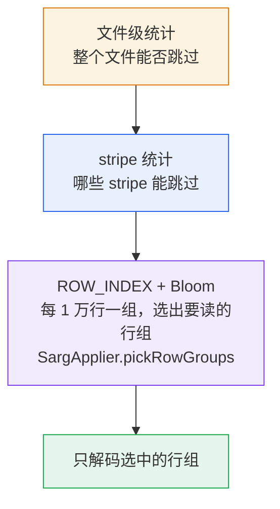
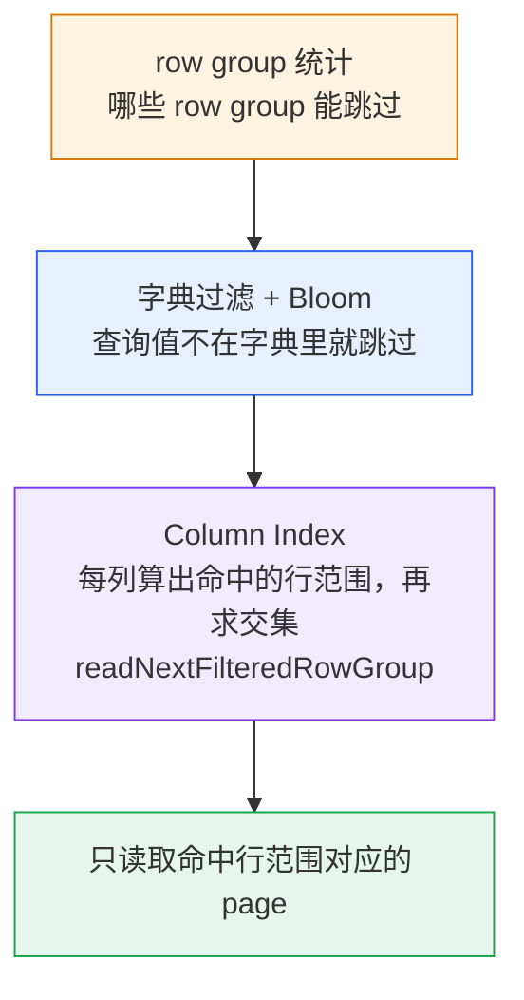

## 1. 文件结构：按层级看

两种格式都可以拆成同样的几层：

| 层级 | 含义 |
|---|---|
| 文件 | 整个文件 |
| 行分块 | 按行切的大块 |
| 列 | 大块里一列的数据 |
| 列内细分 | 一列再拆成的单元 |
| 压缩单位 | 一次压缩 / 解压的数据 |
| 编码单位 | 一段编码后的数据 |
| 索引 | 统计和定位信息 |
| 元数据 | 描述文件内容 |

下面两棵树里，方括号里的标签就是上表的层级，两边标签相同的节点作用相同，名字和细节不同。

### 1.1 层级树

节点颜色表示层级：同一种颜色在 ORC 和 Parquet 里作用相同，名字和细节不同。

#### ORC


### 1.2 磁盘上的实际顺序

层级树是逻辑关系，下面是字节在文件里从左到右的排列，以 3 列为例（a 是 int，b、c 是字符串）。

**ORC 一个 stripe**：先放所有列的索引，再放所有列的数据，最后是 stripe footer。


b 用字典编码（DICTIONARY_V2），c 不同值太多，用直接编码（DIRECT_V2）。每个数据 stream 内部再按 256 KB 切成压缩块。

**Parquet 一个 row group**：一列的所有 page 连续存放，然后是下一列。


"头"是不压缩的 Page Header。c 的字典超过 1 MB 后，后面的 page 回退成 PLAIN，同一个 column chunk 里两种编码并存。row group 里没有索引，索引统一放在文件末尾。

**整个文件**：


### 1.3 层级对照

| 层级 | ORC | Parquet |
|---|---|---|
| 行分块 | Stripe，默认 64 MB。自带索引、数据和 footer | Row Group，默认 128 MB。描述信息都在文件 Footer 里 |
| 列 | 该列在 Row Data 区的若干 stream | Column Chunk |
| 列内细分 | **按用途**拆成 stream：空值、值、长度、字典分开存。每个 stream 覆盖整个 stripe 的行 | **按行数/大小**拆成 page：每个 page 覆盖一段连续的行，空值标记和值放在一起 |
| 压缩单位 | stream 内每 256 KB 一块，和行没有对应关系 | 一个 page 体，正好对应一段行 |
| 编码单位 | RLE v2 段（最多 512 个值）、字节 RLE 段 | RLE / 位打包段（长度不限）、PLAIN 值 |
| 最细的索引 | 每 1 万行一个条目，**所有列对齐** | 每个 page 一个条目，**各列边界不同** |
| 字典范围 | 每个 stripe、每列一份 | 每个 column chunk（即每个 row group、每列）一份 |
| 元数据格式 | Protobuf | Thrift |

> **"按用途拆"和"按行拆"的后果**
>
> ORC 的 stream 覆盖整个 stripe，压缩块的边界和行无关。所以 ORC 的行索引要记三层位置：哪个压缩块、解压后块内的偏移、RLE 段内第几个值，才能从某个 1 万行开始解码。
>
> Parquet 的 page 本身就是一段行，跳过一个 page 就是跳过一段行，Offset Index 只需要记 page 的文件偏移。代价是每列的 page 边界不同，多列过滤时要对各列命中的行范围求交集。

### 1.4 读取路径：从文件末尾到值

**ORC**


**Parquet**


---

## 2. 数据编码

编码是格式自己做的第一层压缩。它知道每列的类型，利用"这一列的数据长什么样"减少字节数，比如值重复、取值范围小、单调递增。编码之后的字节流再交给 zstd 这类通用压缩（第 3 节）。读取时顺序相反：先解压，再解码。

```text
写入：列值 ──▶ 编码（字典 / RLE / 位打包 / 增量）──▶ 通用压缩（zstd / snappy / lz4）──▶ 磁盘
读取：磁盘 ──▶ 解压 ──▶ 解码 ──▶ 列向量 ──▶ 计算引擎
```

本节先用一张表汇总每种数据类型在两种格式里用什么编码（2.1），再逐个讲每种编码的具体实现（2.2），最后用两类典型的列做对比（2.3、2.4）。

### 2.1 汇总：每种类型用什么编码

Parquet 先把逻辑类型映射到物理类型（按 Paimon 1.0 的 `ParquetSchemaConverter`），编码按物理类型选择（`DefaultV1ValuesWriterFactory` / `DefaultV2ValuesWriterFactory`）。ORC 先把一列拆成几个 stream，每个 stream 有固定的编码（`impl/writer/*TreeWriter`）。

| 类型 | Parquet 物理类型 | Parquet v1（Paimon 默认） | Parquet v2 | ORC：stream 及其编码 |
|---|---|---|---|---|
| **string** | BINARY | 字典，回退 PLAIN | 字典，回退 DELTA_BYTE_ARRAY | **字典（DICTIONARY_V2）**：DATA 下标 RLE v2；LENGTH 字典项长度 RLE v2；DICTIONARY_DATA 字典项字节拼接<br>**直接（DIRECT_V2）**：DATA 值的字节拼接；LENGTH 每个值的长度 RLE v2<br>二选一，规则见 2.2 (2) |
| binary | BINARY | 字典，回退 PLAIN | 字典，回退 DELTA_BYTE_ARRAY | DATA 字节拼接；LENGTH RLE v2 |
| tinyint | INT32 | 字典，回退 PLAIN | 字典，回退 DELTA_BINARY_PACKED | DATA 字节 RLE |
| **int / smallint** | INT32 | 字典，回退 PLAIN | 字典，回退 DELTA_BINARY_PACKED | DATA RLE v2（有符号，先 zigzag） |
| **bigint** | INT64 | 字典，回退 PLAIN | 字典，回退 DELTA_BINARY_PACKED | DATA RLE v2（有符号） |
| date | INT32（天数） | 字典，回退 PLAIN | 字典，回退 DELTA_BINARY_PACKED | DATA RLE v2（有符号） |
| timestamp | INT64（精度 ≤ 6）；INT96（精度 > 6） | 字典，回退 PLAIN | 字典，回退 DELTA_BINARY_PACKED | DATA 秒，RLE v2；SECONDARY 纳秒，RLE v2 |
| decimal | 精度 ≤ 9：INT32；≤ 18：INT64；更大：FIXED_LEN_BYTE_ARRAY | INT32 / INT64 同整数；FIXED_LEN 用 PLAIN | 同整数；FIXED_LEN 用字典，回退 DELTA_BYTE_ARRAY | DATA 变长整数；SECONDARY 小数位数（scale），RLE v2 |
| float / double | FLOAT / DOUBLE | 字典，回退 PLAIN | 字典，回退 PLAIN（开启后用 BYTE_STREAM_SPLIT） | DATA 原样 IEEE 754 |
| boolean | BOOLEAN | PLAIN（每值 1 位） | RLE | DATA 每值 1 位 + 字节 RLE |
| **空值**（所有可空列） | — | 定义级别，RLE / 位打包混合编码，和值放在同一个 page | 同 v1 | PRESENT 每行 1 位 + 字节 RLE；stripe 内没有空值时省略 |
| 字典下标 | — | 1 字节位宽 + RLE / 位打包混合编码 | 同 v1 | DATA stream，RLE v2（无符号） |

> **从表里能看出的规律**
>
> - **Parquet 几乎所有类型都先试字典**，字典不合适才回退。v1 回退到 PLAIN，v2 回退到增量类编码。Paimon 默认 v1，所以实际只出现三种编码：字典、PLAIN、RLE / 位打包混合。
> - **ORC 只有字符串用字典**，整数一律用 RLE v2，浮点数原样存储。整数列在 ORC 里不会出现"字典太大"的问题。
> - **两种格式的字典下标、长度、空值都靠整数编码**：Parquet 用 RLE / 位打包混合，ORC 用 RLE v2 和字节 RLE。所以这两种整数编码是理解后面一切的基础。

表里出现的编码一共这几种，下面按顺序逐个讲：

| # | 编码 | 用在哪个格式 | 一句话 |
|---|---|---|---|
| 1 | PLAIN / 原样存储 | 两者 | 值本身，不做变换 |
| 2 | 字典编码 | 两者，规则不同 | 不同值存一份，每行存下标 |
| 3 | RLE / 位打包混合 | Parquet | 重复的值记次数，不重复的按最小位宽打包 |
| 4 | zigzag + RLE v2 | ORC | 每 512 个整数一段，4 种子编码自动选 |
| 5 | 字节 RLE | ORC | 按字节做的游程编码，用于布尔、tinyint、PRESENT |
| 6 | 空值：定义级别 / PRESENT | 两者 | 每行 1 位标记是否为空 |
| 7 | 增量编码和 BYTE_STREAM_SPLIT | Parquet v2 | 存差值或前缀；浮点数按字节拆开 |
| 8 | ORC 的时间和小数 | ORC | 拆成两个整数 stream |

### 2.2 编码详解

#### (1) PLAIN / 原样存储

| 类型 | Parquet PLAIN | ORC 对应的原样部分 |
|---|---|---|
| INT32 / INT64 | 4 / 8 字节，小端序。100 → `64 00 00 00` | 不用原样存储，整数一律用 RLE v2 |
| FLOAT / DOUBLE | 4 / 8 字节 IEEE 754，小端序 | DATA stream 原样 IEEE 754 |
| 字符串 / BINARY | **每个值**：4 字节长度（小端）+ 内容。"abc" → `03 00 00 00 61 62 63`。36 位的 sessionid 占 40 字节 | DIRECT_V2：内容拼在 DATA stream，长度单独放进 LENGTH stream 做 RLE v2。长度相近时，长度 stream 几乎不占空间 |
| BOOLEAN | 每个值 1 位，8 个一字节 | 见字节 RLE |

同样是"原样存字符串"，ORC 把长度和内容分到两个 stream，长度可以再压缩；Parquet v1 的 PLAIN 把长度夹在每个值前面，每个值固定多 4 字节。

#### (2) 字典编码

```text
原始值：   user_a  user_b  user_a  user_c  user_a  user_b
字典：     [user_a, user_b, user_c]
下标：     0 1 0 2 0 1          ← 下标用整数编码存储
```

原理两边一样，差别在**什么时候用、字典存在哪、多大**：

| | Parquet | ORC（只用于字符串） |
|---|---|---|
| 字典存在哪 | 每个 column chunk 开头的 Dictionary Page，字典项用 PLAIN 存 | 每个 stripe 的 DICTIONARY_DATA（字节拼接）+ LENGTH（每项长度） |
| 下标怎么存 | 数据页里：1 字节位宽 + RLE / 位打包混合编码。位宽 = ⌈log₂(字典项数)⌉ | DATA stream，RLE v2 |
| 字典顺序 | 按出现顺序追加 | 排好序（默认 `orc.dictionary.implementation=rbtree`） |
| 读取时 | Paimon 用 `ParquetDictionary.decodeToBinary` 按下标逐个取值 | 整个字典读进一个 `byte[]`，批次里的字符串直接引用它（`setRef`），不拷贝。这个数组要活到 stripe 处理完 |

**Parquet 什么时候用字典：先用，不合适再放弃**（`DictionaryValuesWriter.shouldFallBack` / `isCompressionSatisfying`，`FallbackValuesWriter`）

- 字典超过 `parquet.dictionary.page.size`（默认 **1 MB**）或条目数超限，后面的值改用 PLAIN。
- 写完第一个 page 时，如果"下标大小 + 字典大小 ≥ 原始大小"，也放弃。
- 已经写出的 page 不变，所以一个 column chunk 里可能两种编码并存。
- 每个 row group 重新试一次。

**ORC 什么时候用字典：先统计，再决定**（`StringBaseTreeWriter.checkDictionaryEncoding`，`OrcConf.DICTIONARY_KEY_SIZE_THRESHOLD`）

- 不同值个数 ÷ 非空行数 ≤ `orc.dictionary.key.threshold`（默认 **0.8**）就用字典。
- 在写完**第一个 1 万行**时判断（`orc.dictionary.early.check` 默认开启）；stripe 不到 1 万行就在 stripe 结束时判断。
- **一个文件每列只判断一次**：`doneDictionaryCheck` 置为 true 后不再重置，后面的 stripe 沿用结果。数据排过序时，前 1 万行不一定有代表性。
- 字典**没有大小上限**，每个 stripe 写出并清空一次。

#### (3) RLE / 位打包混合编码（Parquet）

Parquet 里几乎所有整数序列都用它：定义级别、重复级别、字典下标、v2 的布尔值。数据被切成若干段，每段开头是一个变长整数（varint）头，最低位区分两种段：

| 段类型 | 头 | 内容 | 适合 |
|---|---|---|---|
| RLE 段 | `重复次数 << 1`（最低位 0） | 一个值，占 ⌈位宽 / 8⌉ 字节 | 同一个值连续出现 |
| 位打包段 | `(组数 << 1) \| 1`（最低位 1） | 每 8 个值一组，每个值只占"位宽"那么多位，从低位开始紧凑排列 | 值不重复但范围小 |

**例 1：RLE 段。** 排好序的字典下标：0 重复 7000 次，然后 1 重复 13000 次，位宽 1。

```text
[位宽 01] [varint(7000<<1)，2 字节] [00] [varint(13000<<1)，3 字节] [01]
```

2 万个值只用 8 个字节。**RLE 段的长度没有上限**，所以排序后的列在 Parquet 里非常省空间。

**例 2：位打包段**（Parquet 规范里的例子）。值 0 ~ 7，位宽 3，正好一组：

```text
[头 03] [88] [C6] [FA]
```

8 个值占 3 个字节。二进制是 `10001000 11000110 11111010`，从每个字节的低位开始依次放 000、001、010 …

#### (4) zigzag + RLE v2（ORC）

**zigzag**：有符号整数先做 `(n << 1) ^ (n >> 63)`，0, -1, 1, -2, 2 → 0, 1, 2, 3, 4。绝对值小的负数也变成小的正数，后面按位宽打包时不会因为符号位浪费空间。字典下标、长度这类无符号的 stream 不做这一步。

**RLE v2**：每段最多 512 个值，写入时逐段观察数据，从 4 种子编码里自动选一种（`RunLengthIntegerWriterV2`，`MAX_SCOPE = 512`）。每段头的最高 2 位表示子编码类型。下面的字节例子都来自 ORC 规范，都是无符号整数。

| 子编码 | 什么时候用 | 例子 |
|---|---|---|
| **SHORT_REPEAT** | 同一个值重复 3 ~ 10 次 | [10000 × 5] → `0A 27 10`<br>1 字节头（类型、值占几个字节、重复次数）+ 值 10000 的 2 字节 |
| **DIRECT** | 没有规律 | [23713, 43806, 57005, 48879] → `5E 03 5C A1 AB 1E DE AD BE EF`<br>2 字节头（类型、位宽 16、个数 4）+ 每个值 16 位 |
| **DELTA** | 单调递增或递减；重复超过 10 次也用它（差值固定为 0） | [2, 3, 5, 7, 11, 13, 17, 19, 23, 29] → `C6 09 02 02 22 42 42 46`<br>2 字节头 + 起始值 2 + 第一个差值 1（zigzag 后是 2）+ 后面 8 个差值（2,2,4,2,4,2,4,6）每个 4 位。差值全部相同时，只要头 + 起始值 + 差值，没有后面的打包部分 |
| **PATCHED_BASE** | 大部分值集中在一个小范围，个别值特别大 | [2030, 2000, 2020, 1000000, 2040, …]：减去基准值 2000 后，大部分值 6 位就够，1000000 这个离群值的高位单独存进"补丁表"。不然整段都要按 20 位存 |

**和 Parquet 的 RLE / 位打包混合比**：RLE v2 对整数的分布适应性更强，递增、离群值都有专门处理；但每段最多 512 个值，很长的重复要拆成很多段，每段约 4 字节。Parquet 的 RLE 段长度不限，但只认"完全相同"和"范围小"两种情况。

#### (5) 字节 RLE（ORC）

- **格式**：控制字节为 0 ~ 127 时，表示后面 1 个字节重复（控制字节 + 3）次，即 3 ~ 130 次；控制字节为 -1 ~ -128 时，表示后面跟着 1 ~ 128 个原样字节。
- **tinyint**：值本身就是一个字节，直接做字节 RLE。
- **布尔和 PRESENT**：每 8 个值拼成 1 个字节（高位在前），再做字节 RLE。全是 true 的 1 万行，就是几个"重复 130 次的 0xFF"。

#### (6) 空值的表示

| | Parquet：定义级别 | ORC：PRESENT stream |
|---|---|---|
| 存什么 | 每个值一个数字，表示嵌套路径上有几层非空。扁平的可空列最大是 1：1 有值，0 为空 | 每行 1 位：1 有值，0 为空 |
| 编码 | RLE / 位打包混合，v1 page 里前面带 4 字节长度 | 位图 + 字节 RLE |
| 放在哪 | 和值放在同一个 page 体里，先级别后值 | 单独的 stream |
| 没有空值时 | 一个很长的 RLE 段，几个字节 | 整个 stream 省略 |
| 值区 | 只存非空的值 | 只存非空的值 |

嵌套类型（LIST、MAP）在 Parquet 里还要加一组**重复级别**，表示"这个值是新的一行，还是同一个列表里的下一个元素"，同样用 RLE / 位打包混合编码。ORC 用 LENGTH stream 记录每行的元素个数。

#### (7) 增量编码和 BYTE_STREAM_SPLIT（Parquet v2）

| 编码 | 原理 | 适合 |
|---|---|---|
| DELTA_BINARY_PACKED | 存相邻值的差。每 128 个值一个块，块内先减去最小差值，再按位宽打包 | 整数、时间戳、自增 ID |
| DELTA_LENGTH_BYTE_ARRAY | 所有长度用上面的增量编码，内容拼在一起 | 字符串 |
| DELTA_BYTE_ARRAY | 每个值存"和前一个值相同的前缀长度 + 剩下的后缀"，前缀长度和后缀长度都用增量编码 | 排好序、前缀相同的字符串 |
| BYTE_STREAM_SPLIT | 把所有值的第 1 个字节放一起、第 2 个字节放一起……让通用压缩更容易找到规律。默认不开启 | 浮点数 |

> **Paimon 1.0 的默认值**
>
> writer 版本 v1（`ParquetProperties.DEFAULT_WRITER_VERSION = PARQUET_1_0`），这一节的编码都没用上。可以通过 `parquet.writer.version=v2` 打开，但要先确认 Paimon 1.0 的向量化读取支持这些编码。

#### (8) ORC 的时间和小数

- **timestamp**：拆成两个 stream。DATA 存相对 2015-01-01 的秒数，用有符号 RLE v2；SECONDARY 存纳秒，用无符号 RLE v2，纳秒末尾的 0 会先去掉，再用低 3 位记录去掉了几个，所以毫秒精度的时间戳纳秒部分很小。
- **decimal**：DATA 存去掉小数点后的整数，用变长整数（每字节 7 位有效，最高位表示后面还有没有）；SECONDARY 存每个值的小数位数（scale），用 RLE v2。
- **date**：就是天数，一个普通的有符号整数 stream。

### 2.3 同一列在两种格式里的对比

下面用两类典型的列，估算一下两种格式各怎么存。行数和不同值个数是为了说明而假设的。

**低基数的排序列（如 projectid）**：2 万行，P1 × 7000、P2 × 13000，每个值 16 字节。

| Parquet（v1） | ORC |
|---|---|
| 字典页 2 项，约 40 字节；数据页里下标是 2 个 RLE 段，约 8 字节 | DICTIONARY_DATA 32 字节；LENGTH 只有 2 个值，一个 DIRECT 段约 3 字节；DATA 的下标按 512 个一段，共 40 段 DELTA，约 160 字节 |

两种格式都只用了几百字节。ORC 多出来的这点经过 zstd 压缩后几乎看不出来，可以认为差不多。

**高基数的字符串列（如 sessionid）**：一个大块 50 万行，15 万个不同值，每个 36 字节。

| Parquet（v1） | ORC |
|---|---|
| 字典写到约 2.6 万项时超过 1 MB，回退到 PLAIN。之后每个值都按 40 字节存，没有去重 | 比例 0.3 ≤ 0.8，用字典：15 万项约 5.4 MB 的字典 + 每行 18 位的下标 |

**ORC 存储更省**，因为重复的 session 只存一次。代价是读取时每个 stripe 要把这 5.4 MB 的字典整块读进堆里，直到这个 stripe 处理完才释放。

### 2.4 关键差异

| | Parquet（v1） | ORC |
|---|---|---|
| 整数 | 字典编码，或 PLAIN | RLE v2，4 种子编码 |
| 很长的重复 | 一个 RLE 段，长度不限 | 每 512 个值一段 |
| 字符串是否用字典 | 先用，字典超过 **1 MB** 或者不划算就放弃 | 前 1 万行的不同值比例 ≤ **0.8** 就用，**大小不限** |
| 判断范围 | 每个 row group 重新判断 | 每个文件每列判断一次 |
| 字典顺序 | 按出现顺序 | 排好序 |
| 空值 | 定义级别，和值放在同一个 page | 单独的 PRESENT stream |
| 高基数字符串 | 大多回退到 PLAIN，每个值多 4 字节长度 | 多数仍然用字典，存储更省，读取时内存压力更大 |

---

## 3. 通用压缩

### 3.1 压缩在文件里的位置

**ORC：每个 stream 按 256 KB 切块**

```text
一个 stream（比如 c 列的 DATA）
┌───┬──────────────┬───┬──────────────┬───┬──────┐
│头3│ 压缩块 1      │头3│ 压缩块 2      │头3│ 块 3 │
└───┴──────────────┴───┴──────────────┴───┴──────┘
头 = (压缩后长度 << 1) | 是否原样存储
每块解压后最多 256 KB，块之间互不引用
```

- 压缩块和行没有对应关系。行索引要记"块的偏移 + 块内偏移"。
- 压缩后变大的块原样存储，读取时不用解压。

**Parquet：每个 page 体整体压缩**

```text
一个 data page
┌──────────────┬──────────────────────────────┐
│ Page Header  │ 压缩后的 page 体              │
│ （不压缩）    │ = zstd(级别 + 值)             │
└──────────────┴──────────────────────────────┘
Header 里记录压缩前后的大小
字典页也单独压缩
```

- 一个 page 就是一段行，要读就整个 page 解压。
- page 默认 1 MB 或 2 万行，压缩单位比 ORC 大，但每个 page 都单独压缩。

> **压缩单位小带来的影响**
>
> 两种格式的压缩单位都只有几百 KB 到 1 MB，每块单独压缩。所以 zstd 的大窗口在这里发挥不出来，压缩级别从 1 提到 9，压缩率的提升比在大文件上小得多。另外，编码已经去掉了大部分冗余，通用压缩在列存上的压缩率比在普通文本上低。

### 3.2 压缩原理：LZ77 + 熵编码

所有常用的压缩算法都由这两种技术组合而成。

| 技术 | 去掉什么冗余 | 做法 |
|---|---|---|
| **LZ77** | 重复出现的**片段** | 在最近的窗口（几十 KB 到几 MB）里找相同的片段。找到了就写一个 (往回多远 offset, 复制多长 length) 的引用，不再写原文。找不到的字节原样写出，叫 literal。 |
| **熵编码** | 单个**符号**出现频率不均匀 | 给常见的符号分配短码，少见的分配长码。**Huffman** 的码长必须是整数位；**FSE / tANS** 可以用小数位，更接近理论下限。 |

#### 例子：`abracadabra abracadabra`（23 字节 = 184 位）

**第一步 LZ77**：从左往右扫，匹配至少 3 个字节才记引用。

```text
a  b  r  a  c  a  d  [往回7, 长4]  空格  [往回12, 长11]
                     └ "abra"        └ "abracadabra"
10 个 token。按固定位宽存（1 位标记 + 8 位），共 90 位
```

**第二步 Huffman**：统计 token 里每个符号的频率。Deflate 的做法是把 literal 和匹配长度放进同一张符号表，offset 单独一张表。

| 符号 | a | b | r | c | d | 空格 | 长度 4 | 长度 11 | offset 7 | offset 12 |
|---|---|---|---|---|---|---|---|---|---|---|
| 次数 | 3 | 1 | 1 | 1 | 1 | 1 | 1 | 1 | 1 | 1 |
| 码 | `00` | `010` | `011` | `100` | `101` | `110` | `1110` | `1111` | `0` | `1` |

```text
00 010 011 00 100 00 101 1110 0 110 1111 1     共 31 位
184 位（原文）→ 90 位（只做 LZ77）→ 31 位（LZ77 + Huffman，还不包括码表）
```

**解压**：查码表得到符号；遇到 literal 就输出它，遇到引用就从已经输出的内容里往回复制。不需要做任何搜索，所以 LZ 类算法的解压速度和压缩级别基本无关。

真实的实现里还要把码表写进每个块的开头，这在小数据块上占比很高。这也是压缩单位越小越难压缩的原因。

### 3.3 常用算法对比

| 算法 | 结构 | 压缩率 | 压缩 | 解压 | 特点 |
|---|---|---:|---:|---:|---|
| **zstd -1** | LZ77 + Huffman + FSE | **2.896** | 510 MB/s | 1550 MB/s | 压缩率比 gzip 还高，解压快约 4 倍；级别从负数到 22 |
| lz4 | 只有 LZ77，窗口 64 KB | 2.101 | **675 MB/s** | **3850 MB/s** | 解压最快，压缩率最低 |
| snappy | 只有 LZ77，按 64 KB 分块 | 2.089 | 520 MB/s | 1500 MB/s | 压缩率和 lz4 相当，解压更慢 |
| zlib / gzip -1 | LZ77（32 KB）+ Huffman | 2.743 | 105 MB/s | 390 MB/s | 兼容性最好，压缩和解压都慢 |
| brotli -1 | LZ77 + Huffman + 上下文建模 + 静态字典 | 2.883 | 290 MB/s | 425 MB/s | 为网页文本设计，静态字典对二进制数据没用 |
| lzo1x -1 | 只有 LZ77 | 2.106 | 650 MB/s | 780 MB/s | GPL 协议，parquet 需要额外的本地库 |

数据来源：[facebook/zstd README](https://github.com/facebook/zstd)，lzbench 内存测试，Silesia 语料，i7-9700K 单核。只能看相对关系：列存数据已经编码过，压缩率会不同；在 Java 里走 JNI，绝对速度也会更低。

### 3.4 各组件的默认值和实现

| 组件 | 默认 | 说明 |
|---|---|---|
| ORC 库本身 | ZLIB（`orc.compress`），块 256 KB | 可选 NONE / ZLIB / SNAPPY / LZO / LZ4 / ZSTD |
| Parquet 库本身 | UNCOMPRESSED | 可选 SNAPPY / GZIP / LZO / BROTLI / LZ4 / ZSTD / LZ4_RAW。LZ4 是旧的 Hadoop 帧格式，各实现之间有兼容问题，应该用 LZ4_RAW |
| Spark 原生表 | parquet 和 ORC 都是 snappy | `spark.sql.parquet.compression.codec` / `spark.sql.orc.compression.codec` |
| **Paimon 1.0** | **zstd，级别 1** | `file.compression` / `file.compression.zstd-level`，会覆盖上面两种格式的默认值 |
| Paimon 里的 ORC zstd | zstd-jni | Paimon 覆盖了 `org.apache.orc.impl.WriterImpl`，改用自带的 `ZstdCodec`（zstd-jni）。原版 ORC 1.9 用的是纯 Java 的 aircompressor |
| Paimon 里的 Parquet zstd | zstd-jni | parquet 1.13.1 的 `HeapBytesDecompressor` 每解压一个 page 都新建一个 `ZstdInputStream`，用完马上关闭（PARQUET-2160） |

---

## 4. 其他能力对比

### 4.1 统计与索引：能跳过多少数据

| 层级 | ORC | Parquet |
|---|---|---|
| 文件级 | Footer 里的文件级列统计 | 没有单独的文件级统计（可以汇总各 row group 的统计） |
| 大块级 | Metadata 里每个 stripe 的列统计 | Footer 里每个 column chunk 的统计（min/max/null 数等） |
| 细粒度 | **每 1 万行**的 ROW_INDEX，各列边界对齐 | **每个 page** 的 Column Index，各列 page 边界不同，过滤时要对各列命中的行范围求交集（`ColumnIndexFilter`、`RowRanges`） |
| 额外统计 | 整数和（sum）、字符串总长度等 | SizeStatistics（未编码字节数、级别直方图） |
| 字符串 min/max 截断 | 对过长的字符串统计做截断（ORC-203） | Column Index 默认截断到 64 字节 |

### 4.2 Bloom Filter

| | ORC | Parquet |
|---|---|---|
| 粒度 | **每 1 万行一个**，和 ROW_INDEX 对齐 | **每个 column chunk 一个**，也就是每个 row group 一个 |
| 默认 | 不开启，用 `orc.bloom.filter.columns` 指定列，fpp 默认 0.05 | 不开启，fpp 默认 0.01，单个最大 1 MB；支持自适应选择大小 |
| 算法 | 经典 Bloom Filter（UTF8 版本） | Split Block Bloom Filter + xxHash |

注意：这里说的是文件格式自带的 Bloom Filter。Paimon 的 `file-index.bloom-filter.*` 是 Paimon 自己的文件级索引，和这两者无关。

### 4.3 读取时的过滤流程

**ORC**



**Parquet**



两者的粒度相近。ORC 的优势是各列对齐。Parquet 多了一层**字典过滤**：等值查询的值不在 column chunk 的字典里，就能直接跳过整个 row group。Paimon 1.0 读 parquet 时默认打开了 Column Index 过滤，排好序的列可以按 page 跳过。

### 4.4 写入与内存

| | ORC | Parquet |
|---|---|---|
| 写入缓冲 | 每个 writer 缓冲一个 stripe（默认 64 MB），字符串列还要把整个 stripe 的不同值放在内存里 | 每个 writer 缓冲一个 row group（默认 128 MB），字典最多 1 MB 一列 |
| 读取时的长期内存 | 当前 stripe 的字典，大小不限 | 当前 row group 的字典，每列最多 1 MB |
| 多个 writer 并存 | `MemoryManager` 按 `orc.memory.pool`（默认堆的 50%）统一调度 | parquet-hadoop 的 MemoryManager 会按比例缩小 row group |

### 4.5 类型系统

| | ORC | Parquet |
|---|---|---|
| 类型模型 | Hive 风格：基本类型 + STRUCT / LIST / MAP / **UNION** / DECIMAL 等 | 8 种物理类型 + 逻辑类型注解（String、Decimal、Timestamp、**Variant**、Geometry 等） |
| 嵌套结构 | 类型树展开成多列，LIST/MAP 用 LENGTH stream 记元素个数 | Dremel 风格的重复级别 + 定义级别 |
| 新类型扩展 | 需要修改格式规范 | 通过逻辑类型注解扩展 |
| 列级加密 | 支持 | 支持（AES-GCM / AES-GCM-CTR） |

---

## 5. 相同点与不同点

### 5.1 相同点

- **行列混合布局**：先按行切成大块，块内按列存放，只读用到的列。
- **元数据在尾部**：写入时流式追加，读取时先读尾部。
- **编码 + 通用压缩两层**：字典、RLE、位打包之后再 zstd。
- **多级统计和可选的 Bloom Filter**，支持谓词下推。
- **文件写完不能修改**，更新和删除由 Paimon、Iceberg、Hive ACID 等上层实现。

### 5.2 不同点汇总

| 维度 | ORC | Parquet |
|---|---|---|
| 列内细分 | 按用途拆成 stream | 按行拆成 page |
| 压缩单位 | stream 内每 256 KB | 整个 page 体 |
| 最小跳过单位 | 1 万行，各列对齐 | page，各列不对齐 |
| 整数编码 | RLE v2，4 种子编码，每段 ≤ 512 | v1：字典或 PLAIN；RLE 段长度不限 |
| 字符串字典 | 比例 ≤ 0.8 就用，不限大小，每文件判断一次 | 超过 1 MB 回退，每个 row group 重新判断 |
| Bloom 粒度 | 每 1 万行 | 每个 row group |
| 额外过滤 | 行组级 Bloom | 字典过滤 |
| 元数据格式 | Protobuf | Thrift |
| 库的默认压缩 | ZLIB | 不压缩 |

---

## 6. 优势与劣势

**ORC 的优势**

- 索引更细且各列对齐，行组级 Bloom。
- RLE v2 对整数分布适应性强。
- 高基数字符串也能用字典，**存储更省**。
- 统计更全，有 sum、字符串总长度。

**ORC 的劣势**

- **字典不限大小**：读取时堆里有大块长期存活的数据，GC 压力大。
- 字典是否使用只按前 1 万行判断一次。
- 生态较窄，类型扩展不灵活。

**Parquet 的优势**

- 生态最广，Spark、Iceberg、Arrow、DuckDB 都优先支持。
- **字典最多 1 MB**，读取时内存行为稳定。
- 字典过滤，排序列的 RLE 段长度不限。
- 嵌套数据友好，类型扩展灵活。

**Parquet 的劣势**

- 高基数字符串回退到 PLAIN，**文件更大**。
- page 索引各列不对齐，Bloom 粒度粗。
- 每个 page 新建 zstd 解压流，堆外内存频繁申请释放。
- 库的默认值保守（不压缩、v1 page），要靠上层调整。

---

## 附录：源码索引

| 主题 | ORC | Parquet |
|---|---|---|
| 文件结构定义 | `proto/orc_proto.proto` | `parquet-format-structures/src/main/thrift/parquet.thrift` |
| 默认参数 | `OrcConf.java` | `ParquetProperties.java`、`ParquetWriter.java` |
| 整数编码 | `impl/RunLengthIntegerWriterV2.java`、`RunLengthByteWriter.java` | `column/values/rle/RunLengthBitPackingHybridEncoder.java`、`column/values/delta/` |
| 字符串字典 | `impl/writer/StringBaseTreeWriter.java`（写）、`TreeReaderFactory.StringDictionaryTreeReader`（读） | `dictionary/DictionaryValuesWriter.java`、`fallback/FallbackValuesWriter.java` |
| 压缩 | `impl/OutStream.java`、`impl/InStream.java`；Paimon 覆盖版 `org/apache/orc/impl/WriterImpl.java`、`ZstdCodec.java` | `hadoop/CodecFactory.java`（HeapBytesDecompressor）、`hadoop/codec/ZstandardCodec.java` |
| 谓词下推 | `impl/RecordReaderImpl.java` | `filter2/compat/RowGroupFilter.java`、`columnindex/ColumnIndexFilter.java` |
| Paimon 读取 | `paimon-format/.../orc/OrcReaderFactory.java` | `paimon-format/.../parquet/ParquetReaderFactory.java` |

---

*源码版本：ORC 1.9.0-SNAPSHOT；Parquet Java 1.19.0-SNAPSHOT，对照了 1.13.1 标签；Paimon release-1.0。字节例子来自 ORC 和 Parquet 规范。第 2.3 节的行数和不同值个数是假设的。压缩算法性能来自 zstd README 的 lzbench 数据。*
